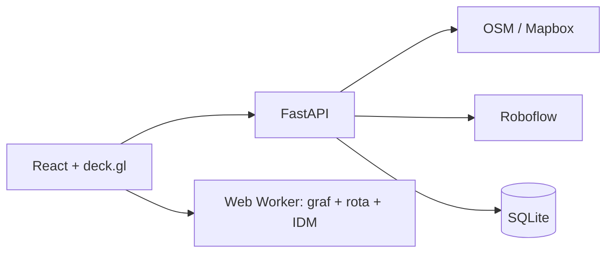

# GeoSim — Kentsel Dijital İkiz ve Trafik Simülasyonu

> **EN:** GeoSim builds an editable digital twin of any selected urban area by merging
> OpenStreetMap buildings and roads with AI-based building detection on Mapbox satellite
> imagery, then runs a microscopic traffic simulation (IDM + Dijkstra) on top of it in the
> browser. Stack: Python, FastAPI, OpenCV, Shapely, React, Vite, deck.gl, Mapbox GL.

GeoSim, seçilen bir bölgenin bina ve yol ağını çıkarıp harita üzerinde düzenlenebilir
bir dijital ikiz oluşturan ve bu ağ üzerinde mikroskobik trafik simülasyonu çalıştıran
bir web uygulamasıdır.

- **Bina tespiti:** OpenStreetMap (Overpass) bina poligonları temel alınır; OSM'de eksik
  olan binalar Mapbox uydu görüntüsü üzerinde yapay zekâ ile (Roboflow instance
  segmentation) tespit edilerek eklenir.
- **Yol ağı:** OSM yolları, kavşak bağlantılarıyla birlikte yönlü bir grafa dönüştürülür.
- **Düzenleme:** Bina/yol çizme, taşıma, silme, yükseklik ve yön bilgisi girme; çalışma
  alanını sürümlü olarak kaydetme ve GeoJSON olarak indirme.
- **Trafik simülasyonu:** Akıllı Sürücü Modeli (IDM), Dijkstra rotalama ve bina alanı ×
  kat sayısına göre talep üretimi. Üç senaryo karşılaştırılır: S0 mevcut ağ,
  S1 yol kapatma, S2 yeni bağlantı yolu. Simülasyon tarayıcıda Web Worker içinde çalışır.

## Teknik odak

- **Backend:** FastAPI uç noktaları, dış servis entegrasyonu, GeoJSON dönüşümü ve SQLite ile sürümlü kayıt.
- **Algoritmalar:** Yol grafı, Dijkstra rotalama, IDM araç takibi ve ortak rastgele tohumlarla senaryo karşılaştırması.
- **Frontend:** React, deck.gl katmanları, düzenleme/geri alma akışı ve Web Worker içinde simülasyon.
- **Doğrulama:** Backend birim testleri; frontend simülasyon, koordinat ve düzenleme testleri. GitHub Actions bu testlerle lint ve production build kontrollerini çalıştırır.



## Gereksinimler

- **Python 3.11+** — <https://www.python.org/downloads/> (kurulumda *Add Python to PATH* seçilmeli; Python 3.12 önerilir)
- **Node.js 22.12+** — <https://nodejs.org/> (Node.js 24 de kullanılabilir)
- İnternet bağlantısı (uydu görüntüsü, OSM ve yapay zekâ servisi için)

İlk kurulumda örnek yapılandırmaları kopyalayın:

```powershell
Copy-Item backend/.env.example backend/.env
Copy-Item frontend/.env.example frontend/.env
```

macOS/Linux üzerinde aynı işlem için `cp` kullanın. Mevcut `.env` dosyanız varsa üzerine yazmayın.
Frontend'deki `VITE_BACKEND_URL` farklı bir backend adresi için değiştirilebilir; varsayılan `http://localhost:8000`.

API anahtarları GitHub deposuna eklenmez. Çalıştırmadan önce `backend/.env` içinde
`MAPBOX_ACCESS_TOKEN` ve `ROBOFLOW_API_KEY`, `frontend/.env` içinde ise
`VITE_MAPBOX_TOKEN` tanımlayın. Varsayılan bina tespiti Roboflow üzerinden yapılır;
PyTorch kurulması gerekmez.

## Çalıştırma

Depoyu klonlayın:

```bash
git clone https://github.com/elanur04/geosim.git
cd geosim
```

Proje ana klasöründe iki ayrı terminal açın; uygulama çalıştığı sürece ikisi de açık
kalmalıdır. Aşağıdaki komutlar Windows içindir; macOS/Linux notu bölümün sonundadır.

**1. terminal — backend**

```powershell
python -m venv .venv
.\.venv\Scripts\python.exe -m pip install -r backend/requirements.txt
cd backend
..\.venv\Scripts\python.exe -m uvicorn api:app --port 8000
```

**2. terminal — frontend**

```powershell
cd frontend
npm.cmd ci
npm.cmd run dev
```

Uygulama tarayıcıda <http://localhost:5173> adresinde açılır. Ortam oluşturma ve
paket kurulumları yalnızca ilk çalıştırmada gereklidir. macOS/Linux'ta ortamı
`source .venv/bin/activate` ile etkinleştirin; backend için `python -m pip` ve
`python -m uvicorn`, frontend için `npm ci` ve `npm run dev` kullanın.

## Kullanım

1. Açılışta **Fatih / Balat** bölgesi analiz edilerek yüklenir.
2. Sol panelden yer arayabilir, koordinat girebilir veya hazır bölgelerden birini
   seçebilirsiniz. Seçilen bölgede önce OSM binaları ve yollar hemen çizilir, ardından
   uydu görüntüsü yapay zekâ ile taranır ve eksik binalar eklenir (~15–30 sn).
3. Haritada binalar kaynağa göre renklendirilir: mavi OSM, yeşil yapay zekâ ile
   eklenen, sarı elle çizilen binalar; turuncu çizgiler yol ağıdır.
4. Sağ panelden bina/yol seçip düzenleyebilir, yeni nesne çizebilir ve çalışma alanını
   kaydedebilirsiniz.
5. **Trafik Simülasyonu** düğmesiyle senaryo, araç yoğunluğu ve oynatma hızını seçip
   simülasyonu başlatabilirsiniz.

## Proje yapısı

```
backend/                    FastAPI sunucusu
  api.py                    Uç noktalar: /analyze, /api/roads, /api/search, /model-status
  vectorize.py              Uydu görüntüsü taraması, maske → poligon, OSM + YZ hibrit birleştirme
  osm_source.py             Overpass'tan özgün OSM bina ve yol geometrileri
  prediction_pipeline.py    Tespitlerin son işlenmesi (yinelenen maskeleri ayıklama)
  building_models.py        Model sağlayıcıları (Roboflow; isteğe bağlı yerel modeller)
  regions.py                Kayıtlı çalışma alanları (SQLite, sürümlü)
  analysis_archive.py       Analiz girdilerinin arşivlenmesi
  evaluate_buildings.py     Elle çizilmiş referansa göre doğruluk (F1) değerlendirmesi
  verification/             Bartın ve İstanbul deney çıktıları
  test_*.py                 Birim testleri
frontend/                   React + Vite + deck.gl arayüzü
  src/components/map/       Harita, düzenleme ve simülasyon panelleri
  src/simulation/           Trafik simülasyonu (graf, IDM, rotalama, talep, senaryolar)
  tests/                    Simülasyon ve düzenleme testleri
  scripts/                  Komut satırından toplu simülasyon deneyleri
```

## Testler

Her komut grubunu proje ana klasöründen açılmış ayrı bir terminalde çalıştırın.

```bash
python -m unittest discover -s backend -p "test_*.py"
npm --prefix frontend test
npm --prefix frontend run lint
npm --prefix frontend run build
```

## İsteğe bağlı: yerel modeller

Varsayılan bina tespiti Roboflow üzerinden yapılır. Yerel GeoAI / YOLOv8 modelleri ve
model eğitimi için ek paketler gerekir:

```bash
pip install -r backend/requirements-ml.txt
```

## Bağlantı gereksinimi ve sorun giderme

Mapbox ve Roboflow özellikleri geçerli API anahtarları, servis kotası ve internet
erişimi gerektirir. Harita açılmazsa önce iki terminaldeki hata mesajlarını kontrol edin.
8000 veya 5173 portu doluysa önce bu portu kullanan eski uygulama oturumunu kapatın.

## Bilinen sınırlar

- Araştırma/eğitim prototipidir; trafik modeli gerçek trafik sayımlarıyla kalibre edilmemiştir.
- OSM kapsamı ve bina tespit başarısı bölgeye göre değişir. `backend/verification/` deney kayıtları, bağımsız ve tüm bölgelere genellenebilir bir doğruluk garantisi değildir.
- Ana harita ve analiz için servis anahtarları gerekir; birim testleri canlı servis anahtarı gerektirmez.
- API'de kullanıcı kimlik doğrulaması yoktur ve CORS geniş açıktır. Genel internete açılmadan önce erişim denetimi ve izin verilen origin listesi düzenlenmelidir.
- Mapbox ve harita kitaplıkları büyük bir frontend paketi üretir; yavaş bağlantılar için yükleme performansı ayrıca ölçülmelidir.
